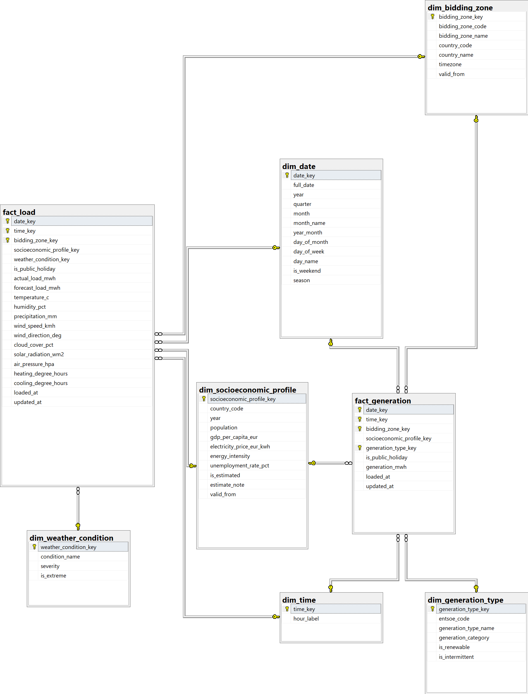

# ENTSO-E Weather Data Platform

A data warehouse that combines European electricity data, weather and socio-economic indicators for
**all 27 EU countries**, hour by hour, in SQL Server, with a four-page Power BI report on top
(see [Power BI report](#power-bi-report))..

| Source | What | Grain |
|---|---|---|
| [ENTSO-E Transparency Platform](https://transparency.entsoe.eu) | actual total load, day-ahead load forecast, actual generation per production type | 28 bidding zones (Denmark has DK1 and DK2), hourly |
| [Open-Meteo](https://open-meteo.com) historical weather (archive API) | temperature, humidity, precipitation, wind, cloud cover, solar radiation, pressure, WMO weather code | 89 representative cities, hourly |
| [Eurostat](https://ec.europa.eu/eurostat) | population, GDP per capita, household electricity price, energy intensity, unemployment rate | country and year |

Loaded period: **2023-01-01 → 2025-12-31** (26,304 hours, UTC): 663,129 load rows and 7.2 million
generation rows.

## Architecture


Solid arrows show the data flow, dotted arrows the control: the SSIS package `ssis/Main_ETL_Process.dtsx`
runs the scripts and procedures, and every step records its status in `etl_log`.

The pipeline is **ELT**: Python extracts the data and loads it into staging tables with only light
cleaning on the way (ENTSO-E 15/30-minute values averaged to hourly, WMO weather codes mapped to condition
names); the business transformations (weather per country, keys, slowly changing dimensions, facts,
updates of changed values) run afterwards as set-based T-SQL inside SQL Server.

## Data model

Two fact tables share the date, time, bidding zone and socio-economic dimensions (diagram exported from
SSMS; history, staging, reference and log tables are not shown):



| Table | Grain | Contents |
|---|---|---|
| `fact_load` | bidding zone × hour | actual load and day-ahead forecast (MWh), the country's weather (average of its cities), heating/cooling degree hours, public-holiday flag |
| `fact_generation` | bidding zone × hour × production type | generation (MWh) |
| `dim_date`, `dim_time` | day, UTC hour | calendar attributes |
| `dim_bidding_zone` (+ `_history`) | zone | name, country, time zone; SCD Type 2 |
| `dim_socioeconomic_profile` (+ `_history`) | country × year | the five Eurostat indicators; SCD Type 2 for revisions; `is_estimated` when a year is not published yet and the latest year is used |
| `dim_generation_type` | ENTSO-E production type (B01–B20, B25) | category, renewable, intermittent |
| `dim_weather_condition` | condition derived from the WMO weather code | severity |
| `ref_public_holiday` | country × date | public holidays (Python `holidays` package) |
| `etl_log` | run / step | start, end, status, row counts, details of every run |

Facts link to the socio-economic figures of **their own year** (2024 energy with 2024 population).
Unknown values stay `NULL`; only keys that cannot be matched point to an "Unknown" row (key 0) and are
counted in `etl_log`. Country totals (e.g. DK1 + DK2) are summed in the report.

## How a run works

The SSIS package runs these tasks in order:

| # | Task | Does |
|---|---|---|
| 1 | Start Run | refuses to start if another run is in progress, opens an `ETL_RUN` row in `etl_log` |
| 2 | Extract ENTSO-E Data | `entsoe_client.py`: 3-month requests, 12 in parallel, rate-limited and retried; sub-hourly values averaged to hourly |
| 3 | Extract Weather Data | `open_meteo_client.py`: one request per city and year, paced to the free API limits |
| 4 | Extract Eurostat Data | `eurostat_client.py`: the five indicators (JSON-stat); any failed or empty query fails the step |
| 5 | Load Reference Data | `reference_loader.py`: bidding zones from `etl/zones.py`, public holidays per country |
| 6 | Load Dimensions | `EXEC dbo.usp_load_dimensions` (dates, SCD Type 2 zones and socio-economic profiles) |
| 7 | Load Facts | `EXEC dbo.usp_load_facts` |
| 8 | Key Check | `fix_null_values.py`: no fact key may be NULL; counts rows on "Unknown" |
| 9 | Finish Run | closes the run as SUCCESS; an OnError handler closes it as FAILED |

Loads are **incremental**: rerunning a period with unchanged data changes nothing, a new period adds
rows, and values that changed at the source (e.g. ENTSO-E corrections) update the stored rows. A stored
value is never replaced by an empty one, so a gap in one download cannot erase data.

## Setup

Requirements (tested on Windows 11):

- SQL Server 2025 (tested with the free Developer edition) and SSMS. The old `Driver={SQL Server}` and
  SQL Native Client do not work with it; use the drivers below.
- Visual Studio with the *SQL Server Integration Services Projects* extension
- Python 3.12, ODBC Driver 18 for SQL Server, OLE DB Driver 19 for SQL Server (used by SSIS)
- A free ENTSO-E API token (Transparency Platform → My Account → Web API Security Token)

Steps:

1. Run `database/create_warehouse.sql`, then `database/load_warehouse.sql` (e.g. in SSMS). Both are safe
   to run again: they only create what is missing and update the procedures.
2. `pip install -r requirements.txt`
3. Set the Windows user environment variable `ENTSO_TOKEN` (see `.env.example`; the token never goes into
   code or the package). `DW_CONNECTION_STRING` is optional; the default is the local `EnergyWeatherDW`
   with Windows authentication.
4. Open `ssis/EnergyWeatherETL.sln`, check the package variables `PythonPath` (default `python.exe` on
   PATH), `ScriptsFolder` (the full path of `etl/`), `StartDate`, `EndDate` (exclusive), `Countries`,
   `SinceYear`, and run `Main_ETL_Process.dtsx`.

The full period takes about **1.5 hours**: ~30 minutes for ENTSO-E (1,008 requests of ~14 s each) and
~1 hour for weather, because the Open-Meteo free tier allows 5,000 weighted calls per hour and the full
period needs ~7,000 (don't run it twice on the same day; the daily limit is 10,000). One month takes
about 3 minutes.

Without SSIS, e.g. to re-run one failed step or test one source, each step also runs on its own
(from `etl/`, with `ENTSO_TOKEN` set; December 2025 as an example period, end date exclusive):

```powershell
python entsoe_client.py --start 2025-12-01 --end 2026-01-01   # task 2 Extract ENTSO-E Data
python open_meteo_client.py 2025-12-01 2026-01-01              # task 3 Extract Weather Data
python eurostat_client.py 2020                                 # task 4 Extract Eurostat Data (all 27 countries since 2020)
python reference_loader.py 2025-12-01 2026-01-01               # task 5 Load Reference Data
```

```sql
EXEC dbo.usp_load_dimensions;   -- task 6 Load Dimensions
EXEC dbo.usp_load_facts;        -- task 7 Load Facts
```

```powershell
python fix_null_values.py                                      # task 8 Key Check
```

The console output also goes to `etl/log/`. The Eurostat extract can be run for a subset of countries or a
later `SinceYear`: the dimension load only rebuilds the country-years the Eurostat staging data covers, keeps
the current version of all others, and never replaces a stored figure by NULL.

## Checking a run

- **`etl_log`**: one `ETL_RUN` row per package run and one row per step, linked by `run_id`, with status,
  row counts and details (rows per data type, days ENTSO-E could not serve, unmatched keys):

  ```sql
  SELECT log_id, run_id, process_name, status, records_processed, start_time, end_time,
         execution_details, error_message
  FROM dbo.etl_log ORDER BY log_id DESC;
  ```

- **`etl/log/`**: the full console output of every script run (`<script>_<date>_<time>.log`, last 30 per
  script). SSIS does not keep this output, so a failed step's `etl_log` row names its log file.
- **`python tools/check_generated_files.py --since 2h`**: lists the files a run wrote outside the repository
  and flags anything unexpected.

## Known data gaps

Coverage is complete (≥ 99.7 % of hours) for 22 of the 28 zones. The gaps are at the source:
ENTSO-E publishes no data for Bulgaria and Malta, almost nothing for Cyprus before mid-2025, only a few
percent of Ireland's day-ahead forecasts and some months of its load; Spain misses 35 hours of the
28 April 2025 blackout.

## Repository layout

| Path | Contents |
|---|---|
| `database/create_warehouse.sql` | the schema: staging, dimensions, facts, reference tables, `etl_log` and its procedures |
| `database/load_warehouse.sql` | T-SQL load procedures and the weather-per-country view |
| `etl/` | Python extract and reference scripts; `zones.py` (countries, bidding zones, Eurostat codes), `etl_log.py` (logging) |
| `ssis/` | SSIS project and package `Main_ETL_Process.dtsx` |
| `tools/check_generated_files.py` | lists generated and local files and where they come from |
| `docs/` | `ETL_Pipeline.png` and `star_schema.png` (the diagrams above) |
| `powerbi/` | the Power BI report as a project (`.pbip`: semantic model and pages) and its theme |

## Power BI report

`powerbi/Data-Warehouse-Energy-Weather-Report.pbip` is a Power BI project: the semantic model is stored as
TMDL and the pages as JSON (PBIR), so the report is versioned as text. It imports the facts and dimensions
of `EnergyWeatherDW`; the data itself is not in git.

| Page | Shows |
|---|---|
| Overview | key figures; renewable share by country on a map (20 % classes); monthly generation by source with demand; generation mix by year |
| Load & forecast | monthly day-ahead forecast error or bias (switch), forecast error by country, average demand by weekday and hour (UTC), demand on weekends and public holidays compared with working days |
| Generation mix | average generation by hour of day and source, the ten largest production types, renewable share per month, generation mix per country |
| Weather & socio-economics | daily demand against temperature by season, heating and cooling degree days per country, demand per person against GDP per person, a socio-economic profile per country |

All pages share the Year and Country slicers. Chart titles state the main finding for the current
selection (e.g. "Demand peaked in Jan 24 at 242.5 TWh") and change with the slicers. Bulgaria and Malta are
excluded by a report-level filter because ENTSO-E has no data for them.

How the figures are calculated:

- Energy is summed; temperature, humidity, wind and other weather values are averaged; shares and ratios are
  calculated from sums (e.g. renewable share = renewable generation / all generation).
- Forecast error = Σ|forecast − actual| / Σ actual and bias = Σ(forecast − actual) / Σ actual, over hours
  with both values.
- Population is averaged over the selected years, never summed. Demand per person only uses country-years
  with at least 95 % of hours covered by load data, so incomplete data gives no value instead of a too-low
  one (Cyprus: none; Ireland: 2024 only). GDP per person, electricity price and unemployment are
  population-weighted for groups of countries.
- Demand on weekends and public holidays is compared with working days within each bidding zone, because
  public holidays differ per country.

To open it: Power BI Desktop (tested with version 2.159) → open the `.pbip` → **Home → Refresh**. The model
connects to `localhost`, database `EnergyWeatherDW`, with Windows authentication; the first refresh loads
the 7.9 million fact rows and takes a few minutes. The colours come from `powerbi/theme/EnergyWeatherTheme.json`,
which is already registered in the report.

## Data sources and terms

Electricity data: ENTSO-E Transparency Platform. Weather data: Open-Meteo.com (CC BY 4.0).
Socio-economic data: © European Union, Eurostat. Use of the data is subject to each source's terms.
