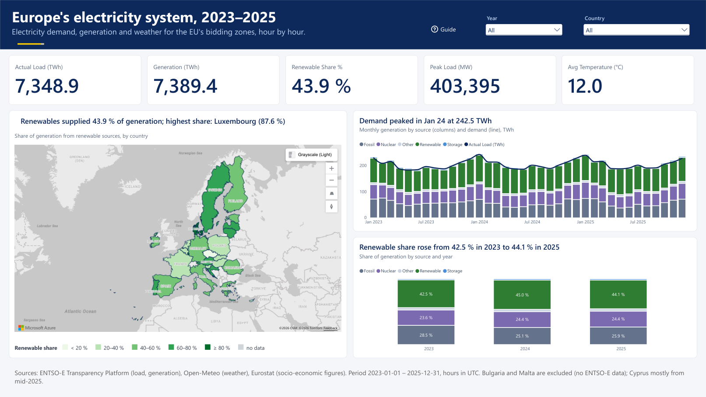
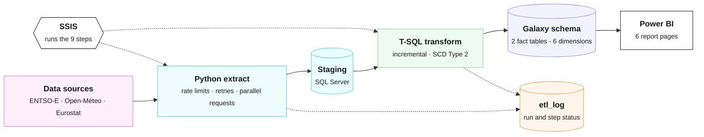
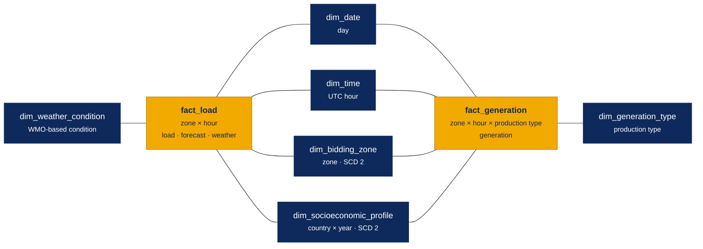
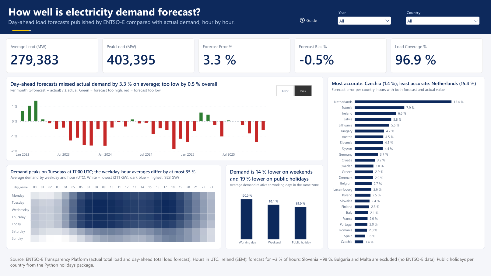
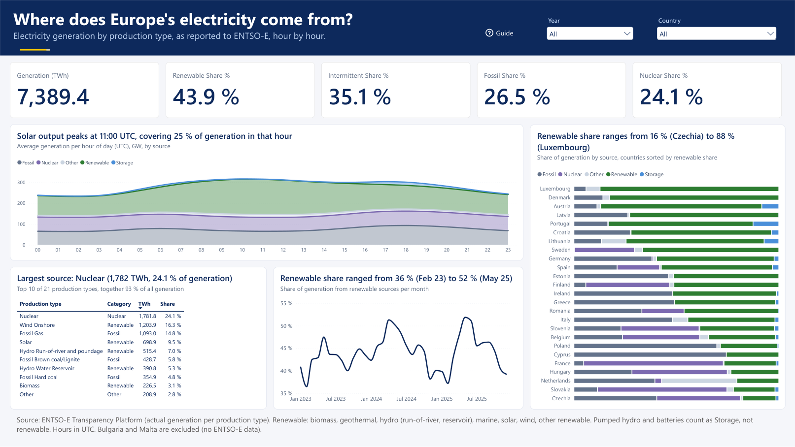
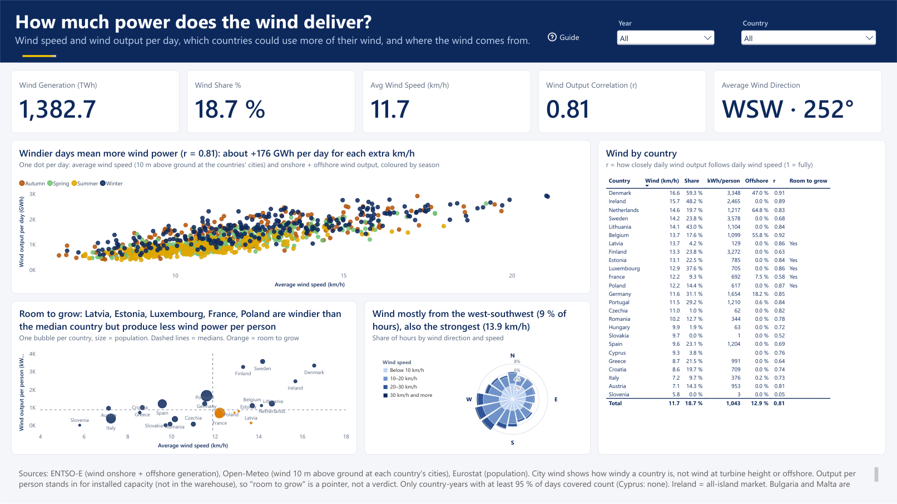
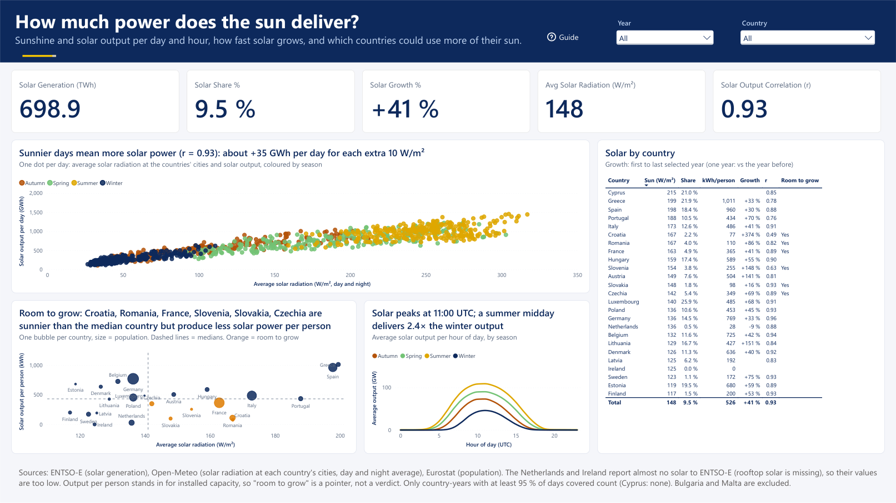
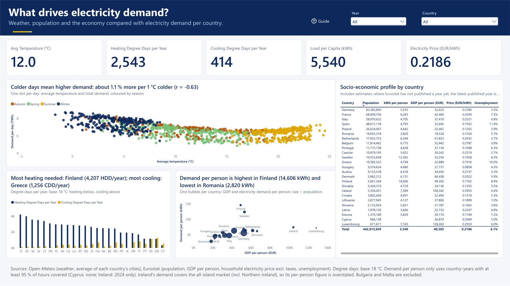

# Energy & Weather Data Platform

A data warehouse that combines **European electricity data, weather and the economy, hour by hour, for all
27 EU countries** from 2023 to 2025, built with Python, SSIS and SQL Server, and reported in Power BI.

## The business case

**Audience:** European representatives and the energy-policy teams who advise them on where EU funding
for renewable energy should go.

**The question:** *in which countries would new wind and solar capacity make the most difference?*

Funding decisions are usually made from yearly national statistics. This dashboard puts hourly
electricity data from the grid operators next to the weather that drives wind and solar output and the
economic situation of each country, so the answer rests on four kinds of evidence:

| Lens | What the dashboard shows | Example finding (2023–2025) |
|---|---|---|
| **Untapped resource** | countries with more wind or sun than the median country but less wind or solar output per person | wind: Latvia, Estonia, Luxembourg, France, Poland; solar: Croatia, Romania, France, Slovenia, Slovakia, Czechia |
| **Fossil dependence** | where the generation mix still relies on fossil fuels, so new renewables would replace the most fossil generation | renewable share ranges from 16 % (Czechia) to 88 % (Luxembourg) |
| **Momentum** | where renewables are already growing fast and where they lag behind | EU solar generation +41 % from 2023 to 2025, with large differences between countries |
| **Grid readiness** | how predictable demand is and how closely wind and solar follow the weather, which shows where storage, grid and forecasting need to grow along with new capacity | day-ahead forecast error from 1.4 % (Czechia) to 15.4 % (Netherlands) |

Economic context (GDP and demand per person, household electricity prices) shows how much a country can
invest by itself and how much households would gain from cheaper electricity.

The dashboard points to where a closer look is worthwhile; it does not replace a feasibility study. It
does not include installed capacity, grid connections, land use, costs or national policy. Output per
person stands in for installed capacity until ENTSO-E capacity data is added.

## The questions behind it

- **Demand:** how much do weather, weekdays, public holidays and the economy change electricity demand?
- **Forecasts:** how accurate are the grid operators' day-ahead demand forecasts, and where do they miss?
- **Generation mix:** where does Europe's electricity come from, and how fast is the mix changing?
- **Wind and solar:** how closely do they follow the weather, and which countries could use more of it?

Answering these needs electricity, weather and economic data on one time axis, which no single source
provides.

## At a glance

| | |
|---|---|
| **Coverage** | 27 EU countries, 28 bidding zones, 1 Jan 2023 – 31 Dec 2025: 26,304 hours (UTC) |
| **Sources** | 3 public APIs: ENTSO-E Transparency Platform, Open-Meteo, Eurostat |
| **Warehouse** | galaxy schema (2 fact tables sharing their dimensions), 7.9 million fact rows, SCD Type 2 history |
| **Pipeline** | 9-step SSIS package, incremental and safe to rerun, full load in about 1.5 hours |
| **Report** | 6 Power BI pages with titles that state the finding and update with the filters |
| **Stack** | SQL Server 2025 · T-SQL · SSIS · Python 3.12 (pandas, pyodbc, requests) · Power BI (DAX, PBIP, Deneb) |

## Architecture

The pipeline is **ELT**. Python scripts extract the data from the three APIs, handling rate limits,
retries and parallel requests, and load it into staging tables. The business transformations (weather
per country, keys, slowly changing dimensions, facts) then run as set-based T-SQL inside SQL Server. One
SSIS package runs all nine steps in order, and every step records its status and row counts in a log
table.

Loads are **incremental**: rerunning a period changes nothing, a new period only adds rows, and
corrections published by the source update the stored values.

→ [Data sources](docs/01-data-sources.md) · [ETL pipeline](docs/02-etl-pipeline.md)

## Data model

The warehouse is a **galaxy schema** (fact constellation): two fact tables at their natural grain share the date, hour, bidding zone and socio-economic
dimensions: `fact_load` (zone × hour: demand, forecast, weather) and `fact_generation`
(zone × hour × production type). Eurostat figures are linked by **country and year**, so 2024 energy is
compared with 2024 population, and revisions are kept as history (SCD Type 2).

→ [Data model](docs/03-data-model.md) · [Logging and data quality](docs/04-data-quality.md)

## Power BI report

Six pages with shared Year and Country filters. Each chart title states the main finding for the current
selection (for example "Demand peaked in Jan 24 at 242.5 TWh"), and a **Guide** button on every page
explains how to read it.

| | |
|---|---|
|  **Load & forecast:** forecast accuracy by month and country, demand by weekday and hour, weekends and holidays |  **Generation mix:** sources by hour of day, month and country, the largest production types |
|  **Wind:** wind speed vs wind output, wind rose, countries with room to grow |  **Solar:** sunshine vs solar output, daily profile by season, growth per country |
|  **What drives demand:** temperature, heating and cooling degree days, GDP and demand per person | |

Some findings for 2023–2025: renewables supplied **43.9 %** of generation; day-ahead forecasts missed
actual demand by **3.3 %** on average; demand rises about **1.1 % per 1 °C colder**; daily wind output
follows wind speed with **r = 0.81**, and solar output follows radiation with **r = 0.93**.

→ [Power BI report](docs/05-power-bi-report.md)

## Documentation

| Document | Contents |
|---|---|
| [01 Data sources](docs/01-data-sources.md) | the three APIs, what is extracted, limits and quirks |
| [02 ETL pipeline](docs/02-etl-pipeline.md) | the SSIS package step by step, ELT, incremental loads, run times |
| [03 Data model](docs/03-data-model.md) | galaxy schema, tables and grain, SCD Type 2, missing-value rules |
| [04 Logging and data quality](docs/04-data-quality.md) | run log, checks, coverage per country, known gaps at the source |
| [05 Power BI report](docs/05-power-bi-report.md) | the six pages, how the figures are calculated, the report as code |
| [06 Setup](docs/06-setup.md) | requirements, installation, running the pipeline, troubleshooting |

## Repository layout

| Path | Contents |
|---|---|
| [`database/`](database/) | schema (`create_warehouse.sql`) and T-SQL load procedures (`load_warehouse.sql`) |
| [`etl/`](etl/) | Python extract and reference-data scripts, shared country/zone list and logging |
| [`ssis/`](ssis/) | SSIS project with the package `Main_ETL_Process.dtsx` |
| [`powerbi/`](powerbi/) | Power BI report as a project (`.pbip`: model in TMDL, pages in JSON) and its theme |
| [`tools/`](tools/) | check of generated files; generators for report pages |
| [`docs/`](docs/) | the documents above and their images |

## Data sources and terms

Electricity data: [ENTSO-E Transparency Platform](https://transparency.entsoe.eu). Weather data:
[Open-Meteo.com](https://open-meteo.com) (CC BY 4.0). Socio-economic data: © European Union,
[Eurostat](https://ec.europa.eu/eurostat). Use of the data is subject to each source's terms.
