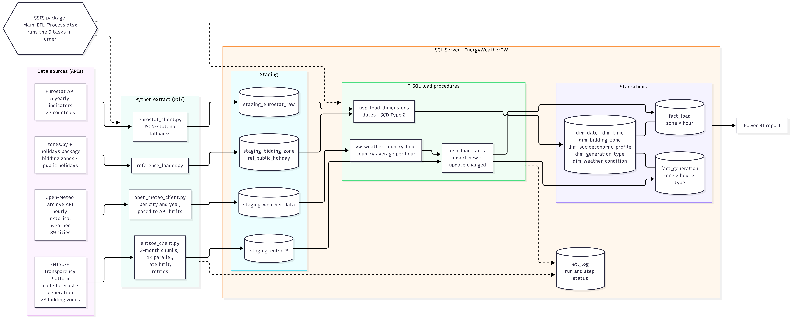

# 02 ETL pipeline

[← Data sources](01-data-sources.md) · **ETL pipeline** · [Data model →](03-data-model.md)

Solid arrows show the data flow, dotted arrows the control: the SSIS package runs the scripts and
procedures, and every step records its status in `etl_log`.

## ELT: extract in Python, transform in SQL Server

| Layer | Technology | Does |
|---|---|---|
| Extract | Python | API calls, rate limiting, retries, parallel requests, parsing XML / JSON / JSON-stat; light cleaning only (15/30-minute values averaged to the hour, WMO codes mapped to conditions) |
| Staging | SQL Server tables `staging_*` | the raw extract, truncated and refilled by each run |
| Transform and load | T-SQL stored procedures | weather per country, keys, slowly changing dimensions, facts, updates of changed values, unmatched-key counts |
| Orchestration | SSIS | runs the steps in order, passes parameters, closes the run as FAILED on any error |

The transforms first lived in Python, as row-by-row pandas code. Timing a 3-day run and extrapolating to
the 3-year period showed that it could not work: the energy aggregation scaled quadratically (days of run
time) and the memory needed was larger than the machine had free. Rewritten as set-based T-SQL, the fact
load for all **7.9 million rows takes about 3.5 minutes**, and no data leaves the database.

## The SSIS package step by step

[`ssis/Main_ETL_Process.dtsx`](../ssis/Main_ETL_Process.dtsx) runs nine tasks in order. An OnError
handler closes the run as FAILED as soon as any task fails.

| # | Task | Runs | Writes |
|---|---|---|---|
| 1 | Start Run | `EXEC dbo.usp_etl_run_start` | opens an `ETL_RUN` row in `etl_log`; refuses to start while another run is in progress |
| 2 | Extract ENTSO-E Data | [`entsoe_client.py`](../etl/entsoe_client.py) | `staging_entso_actual_load`, `_forecast`, `_generation` |
| 3 | Extract Weather Data | [`open_meteo_client.py`](../etl/open_meteo_client.py) | `staging_weather_data` (hourly, per city) |
| 4 | Extract Eurostat Data | [`eurostat_client.py`](../etl/eurostat_client.py) | `staging_eurostat_raw` (5 indicators); any failed or empty query fails the step |
| 5 | Load Reference Data | [`reference_loader.py`](../etl/reference_loader.py) | bidding zones from `zones.py`, public holidays per country |
| 6 | Load Dimensions | `EXEC dbo.usp_load_dimensions` | dates, bidding zones and socio-economic profiles (SCD Type 2) |
| 7 | Load Facts | `EXEC dbo.usp_load_facts` | `fact_load`, `fact_generation` |
| 8 | Key Check | [`fix_null_values.py`](../etl/fix_null_values.py) | no fact key may be NULL; counts rows on "Unknown" keys |
| 9 | Finish Run | `EXEC dbo.usp_etl_run_end` | closes the run as SUCCESS |

Package parameters set the period (`StartDate`, `EndDate`, end exclusive), the countries, the first
Eurostat year, the Python path and the connection string. The ENTSO-E token is never stored in the
package: the scripts read it from an environment variable.

## What the load procedures do

All procedures are in [`database/load_warehouse.sql`](../database/load_warehouse.sql).

**Weather per country** (`vw_weather_country_hour`). For every country and hour: the average of its
cities for temperature, humidity, precipitation, wind speed, cloud cover, radiation and pressure; the
**circular mean** for wind direction (average of the wind vectors, so 350° and 10° give 0°, not 180°);
the most frequent weather condition. Averages are computed in exact `DECIMAL`, so the result does not
depend on the order in which a parallel query plan adds the values.

**Degree hours.** Heating and cooling degree hours against a base of 18 °C, divided by 24 so that a day
sums to degree days: `max(18 − T, 0) / 24` and `max(T − 18, 0) / 24`.

**Dimensions** (`usp_load_dimensions`). New dates are added; bidding zones and socio-economic profiles
are compared with the stored version by a row hash, and a changed row gets a new version (SCD Type 2,
see [Data model](03-data-model.md#yearly-figures-and-history)).

**Facts** (`usp_load_facts`). Each fact row is matched to its zone, its country's weather in the same
hour, its country's public holidays and the socio-economic profile of **its own year**. Keys that cannot
be matched point to the "Unknown" row (key 0) and are counted.

## Incremental and safe to rerun

| Situation | Result |
|---|---|
| rerun a period with unchanged data | nothing changes (tested: 0 inserts, 0 updates) |
| run a new period | only new rows are added |
| ENTSO-E corrected a value, or late data arrived | the stored row is updated, `updated_at` is set |
| a value is missing in the new download | the stored value is kept; a value is never replaced by NULL, a known key never by "Unknown" |

Each fact procedure stages the new rows in a temporary table, then runs one `UPDATE` for rows whose
values differ and one `INSERT … WHERE NOT EXISTS` for new rows, in one transaction. The comparison uses
`EXISTS (SELECT new … EXCEPT SELECT old …)`, which treats two NULLs as equal, so unchanged rows with
missing values are not updated again and again. Nothing is deleted.

The Eurostat load works the same way: a run for a subset of countries or later years rebuilds only the
country-years it covers and keeps the others.

## Run times

| Part | Full period (3 years) |
|---|---|
| Extract ENTSO-E | ~30 min (1,008 requests of ~14 s, 12 in parallel) |
| Extract weather | ~1 hour (limited by the Open-Meteo free tier: 5,000 weighted calls per hour) |
| Extract Eurostat, reference data | < 1 min |
| Load dimensions and facts | ~4 min |
| **Total** | **~1.5 hours** |

One month takes about 3 minutes. How to run the package or single steps is described in
[Setup](06-setup.md#running-the-pipeline).

---

[← Data sources](01-data-sources.md) · [Data model →](03-data-model.md)
