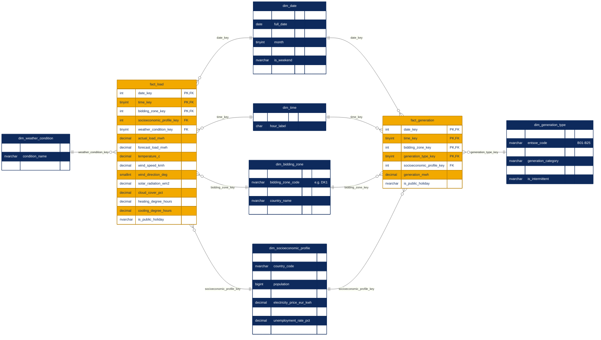
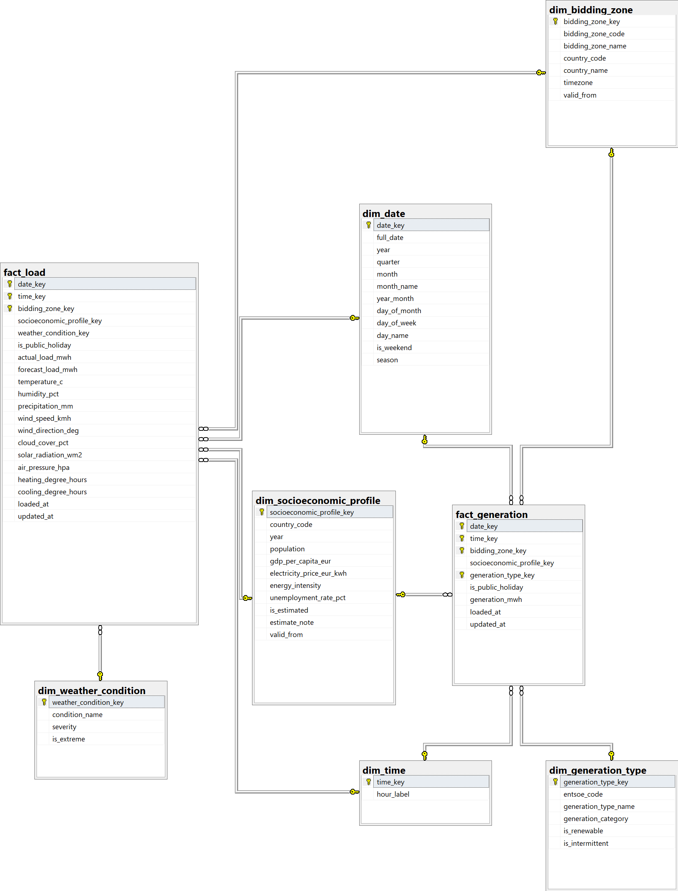

# 03 Data model

[← ETL pipeline](02-etl-pipeline.md) · **Data model** · [Logging and data quality →](04-data-quality.md)

The warehouse `EnergyWeatherDW` is a **galaxy schema** (also called a fact constellation) in SQL Server:
two fact tables at different grains that share their dimensions. Each fact table with its dimensions is a
star; the shared (conformed) dimensions join the two stars, so load and generation can be filtered by the
same date, hour, zone and country-year and compared in one report. The whole schema is defined in one file,
[`database/create_warehouse.sql`](../database/create_warehouse.sql), which can be run any number of
times: it creates what is missing and never drops tables or data.

*Main columns only; history, staging, reference and log tables are not shown.*

The same model in the live database (SSMS database diagram):

## Fact tables

| Table | Grain | Rows (2023–2025) | Measures |
|---|---|---|---|
| `fact_load` | bidding zone × hour | 663,129 | actual load and day-ahead forecast (MWh); the country's weather in that hour (temperature, humidity, precipitation, wind speed and direction, cloud cover, solar radiation, pressure); heating and cooling degree hours |
| `fact_generation` | bidding zone × hour × production type | 7,211,022 | generation (MWh) |

**Why two fact tables.** Load is measured per zone and hour, generation per zone, hour and production
type. In a single table at the finer grain, the load of a zone-hour is repeated on every production-type
row (up to 20 times), and every sum of load is wrong. Two tables at their natural grain store each
measure once, so plain sums are correct and the report needs no special handling.

Both tables have a primary key on their grain, `loaded_at` (first insert) and `updated_at` (last change
by a reload).

## Dimensions

| Table | One row per | Attributes | Type |
|---|---|---|---|
| `dim_date` | day | year, quarter, month, day of week, weekend flag, season | fixed |
| `dim_time` | UTC hour (0–23) | hour label | fixed |
| `dim_bidding_zone` | bidding zone (28) | name, country, time zone | SCD Type 2 |
| `dim_socioeconomic_profile` | country × year | population, GDP per person, electricity price, energy intensity, unemployment rate, estimate flag | SCD Type 2 |
| `dim_generation_type` | ENTSO-E production type (B01–B20, B25) | name, category (renewable, fossil, nuclear, storage, other), renewable flag, intermittent flag | fixed |
| `dim_weather_condition` | weather condition | name, severity, extreme flag | fixed |

Supporting tables: `ref_public_holiday` (country × date), the `staging_*` tables written by the
extracts, and `etl_log` (see [Logging and data quality](04-data-quality.md)).

**Classification choices.** Pumped hydro storage (B10) and batteries count as **storage**, not renewable,
because they store electricity that was generated elsewhere. Wind and solar are flagged as
**intermittent** (weather-driven).

## Time

The grain is **one hour in UTC**. UTC is the only time axis without missing or repeated hours at
daylight-saving changes, and it lines up all countries. ENTSO-E values for 15 or 30 minutes are averaged
to the hour. `date_key` is `yyyymmdd`, `time_key` the UTC hour.

## Weather per country, facts per zone

Weather comes from 89 cities and is reduced to one value per country and hour (the average of its cities;
see [ETL pipeline](02-etl-pipeline.md#what-the-load-procedures-do)). Energy facts stay per bidding zone, so
both Danish zones carry the Denmark weather. Country totals such as DK1 + DK2 are summed in the report.

## Yearly figures and history

**Each fact uses the figures of its own year.** Eurostat figures are stored per country and year
(`year` is part of the key), and each fact links to its country's profile for the fact's year: 2023
energy is compared with 2023 population, 2024 energy with 2024 population.

**A year not published yet** (Eurostat publishes with a delay) uses the latest published year and is
flagged with `is_estimated` and a note such as "from 2024", so the report can say so.

**Revisions are kept (SCD Type 2).** When Eurostat revises an already loaded figure, or an attribute of a
bidding zone changes, the current version is closed and a new one is added (illustrative values):

| country | year | population | valid_from | valid_to | is_current |
|---|---|---|---|---|---|
| PL | 2022 | 36.80 M | 2023-03-15 | 2024-03-09 | No |
| PL | 2022 | 36.75 M | 2024-03-10 | 9999-12-31 | Yes |

`valid_from` / `valid_to` record **when a version was loaded**, not which year the figure describes.

**Implementation.** Each SCD dimension is two tables: `*_history` holds every version (`row_hash`,
`valid_from`, `valid_to`, `is_current`), and `dim_*` holds the current version with one row per durable
key. Facts reference the durable key with a real foreign key, so a new version never requires updating
millions of fact rows, and the report always sees the current figures.

## Missing values

**Unknown stays unknown.** Every number comes from a source or from a documented calculation on source
values. Power BI leaves NULL out of sums and averages, so NULL gives correct totals and lets the report
show "no data".

| Kind of value | Rule |
|---|---|
| measured values | NULL when the source has none; 0 only when the source says 0 |
| weather per country | average of the cities that have a value; NULL if none has one |
| calculated values (degree hours) | only when all inputs exist |
| yearly figures | NULL when Eurostat has none; the latest year, flagged, for a year not published yet |
| keys | never NULL: no match → the "Unknown" row (key 0), counted in `etl_log` |
| missing hours or countries | no row, never a row of zeros |

Ratios (renewable share, forecast error, demand per person) are not stored. They are calculated in the
report from sums, so they are correct for any selection of countries and years.

---

[← ETL pipeline](02-etl-pipeline.md) · [Logging and data quality →](04-data-quality.md)
