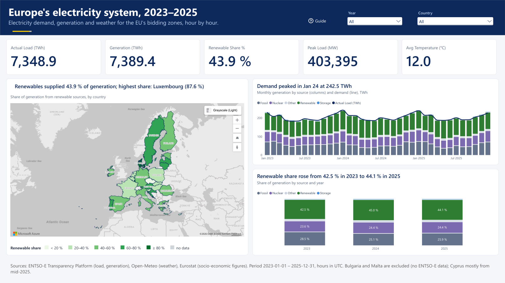
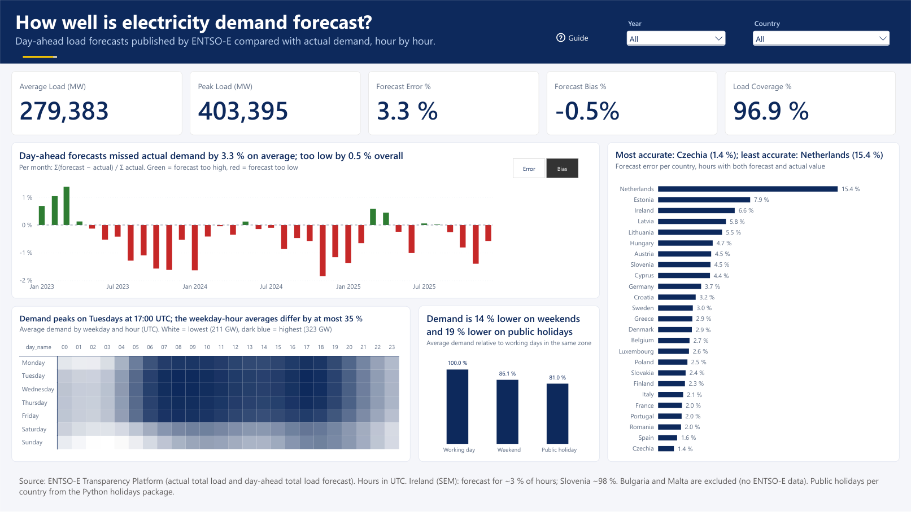
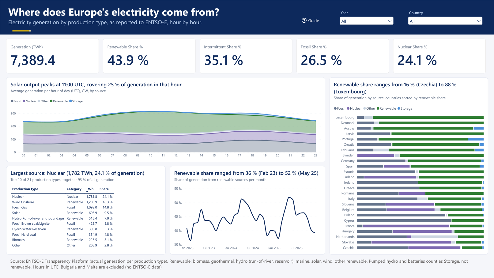
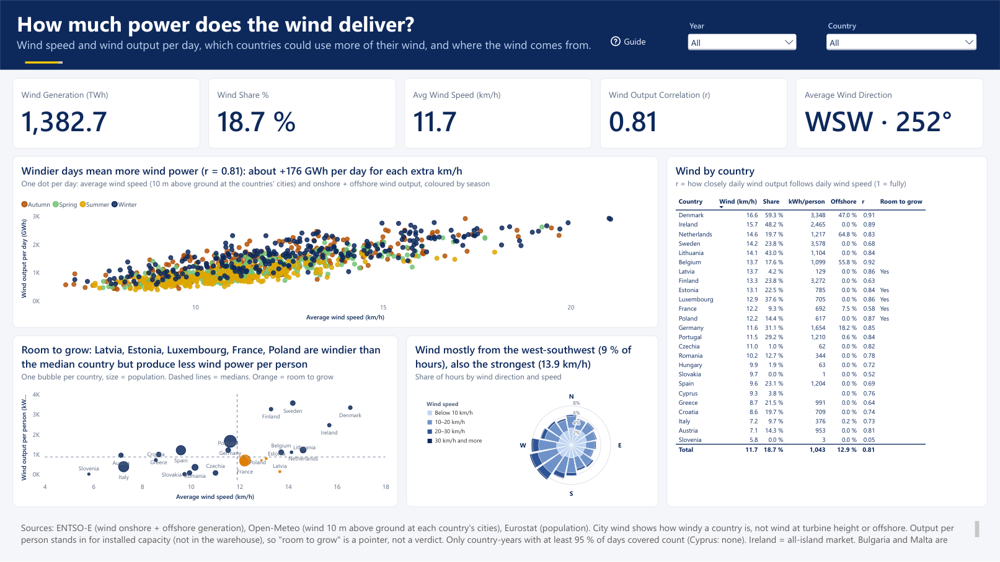
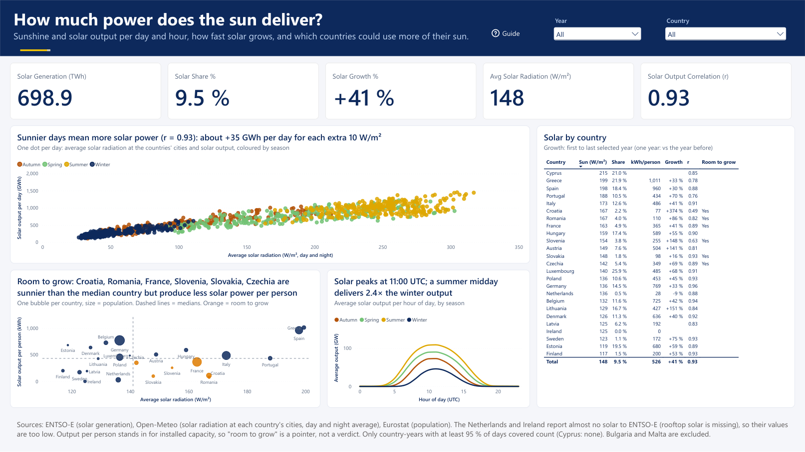
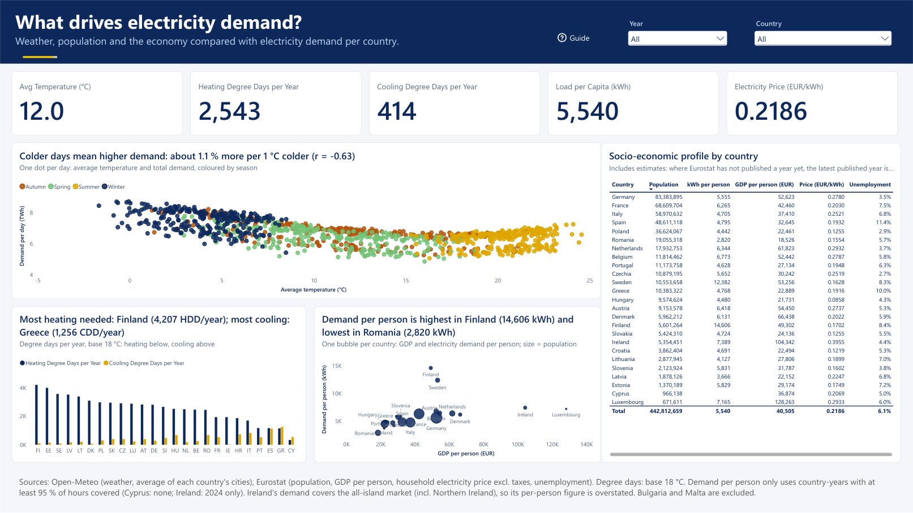

# 05 Power BI report

[← Logging and data quality](04-data-quality.md) · **Power BI report** · [Setup →](06-setup.md)

Six pages that tell one story: how much electricity Europe uses, how well it is forecast, where it comes
from, how wind and solar follow the weather, and what drives demand.

**Purpose.** The report is designed for European representatives and their energy-policy advisers who
decide where EU funding for renewable energy should go. Each page answers one part of the question *"where
would new wind and solar capacity make the most difference?"*:

| Page | Investment question it answers |
|---|---|
| Overview | which countries still generate little from renewables, and how fast is the EU mix changing? |
| Load & forecast | where is demand hard to predict, so that more weather-driven generation would also need storage and better forecasting? |
| Generation mix | which countries depend most on fossil fuels, so that new renewables would replace the most fossil generation? |
| Wind | which countries have strong wind but produce little wind power per person? |
| Solar | which countries have strong sun but produce little solar power per person, and where is solar growing fastest? |
| What drives demand | how do the climate, GDP and electricity prices differ, and how much can each country invest by itself? |

The report shows where a closer look is worthwhile; it is not a feasibility study. It does not contain
installed capacity, grid limits, land use, costs or national policy.

**Design principles**

- **Titles state the finding.** Every chart title is a DAX measure that describes what the chart shows for
  the current selection, for example "Demand peaked in Jan 24 at 242.5 TWh" or "Most accurate: Czechia
  (1.4 %); least accurate: Netherlands (15.4 %)". The titles change with the filters.
- **Same filters everywhere.** Year and Country are synced across all pages.
- **A Guide on every page.** The "Guide" button opens an overlay with numbered badges on the visuals and
  a panel explaining how to read the page, what the numbers mean and what to look for.
- **Gaps are visible.** Each page footer names its sources and data gaps. Bulgaria and Malta are excluded
  by a report-level filter because ENTSO-E has no data for them.

## Pages

### Overview: Europe's electricity system, 2023–2025



Key figures (demand, generation, renewable share, peak load, temperature); renewable share by country on a
map in 20 % classes; monthly generation by source with demand as a line; the generation mix per year.

### Load & forecast: how well is electricity demand forecast?



The day-ahead forecast error or bias per month (switched with buttons; bias in green for too high and red
for too low), forecast error per country, average demand by weekday and UTC hour as a heatmap, and demand
on weekends and public holidays compared with working days.

### Generation mix: where does Europe's electricity come from?



Average generation by hour of day and source, the ten largest production types, the renewable share per
month, and the generation mix per country sorted by renewable share.

### Wind: how much power does the wind deliver?



Daily wind output against wind speed by season, with correlation and slope in the title; "room to grow":
countries windier than the median that produce less wind power per person than the median; a wind rose
(a Deneb / Vega-Lite custom visual: 16 directions × speed bands, share of hours); a country table.

### Solar: how much power does the sun deliver?



Daily solar output against solar radiation by season, the average output per hour of day by season,
"room to grow" as on the Wind page, and a country table with growth from the first to the last selected
year.

### What drives electricity demand?



Daily demand against temperature by season, heating and cooling degree days per country, GDP per person
against demand per person (bubble size = population), and a socio-economic profile for every country.

## Selected findings (2023–2025, all countries)

| Finding | Value |
|---|---|
| share of generation from renewables | 43.9 % (42.5 % in 2023 → 44.1 % in 2025) |
| day-ahead forecast error (average) | 3.3 %, from 1.4 % (Czechia) to 15.4 % (Netherlands) |
| demand on weekends / public holidays vs working days | −14 % / −19 % |
| demand per 1 °C colder | about +1.1 % (r = −0.63) |
| wind output vs wind speed, daily | r = 0.81, about +176 GWh per day per km/h |
| solar output vs radiation, daily | r = 0.93; solar generation +41 % from 2023 to 2025 |

## How the figures are calculated

- **Sums and averages.** Energy is summed; temperature, wind, radiation and the other weather values are
  averaged; population is averaged over the selected years, never summed.
- **Ratios from sums.** Shares are calculated from sums, not averaged from percentages:

  ```dax
  Renewable Share % =
  DIVIDE (
      CALCULATE ( [Generation (MWh)], dim_generation_type[is_renewable] = "Yes" ),
      [Generation (MWh)]
  )
  ```

- **Forecast error and bias** only over hours that have both values:
  error = Σ|forecast − actual| / Σ actual, bias = Σ(forecast − actual) / Σ actual.
- **Correlation (r)** is Pearson's r over the days in the selection, written in DAX (no built-in function).
- **Coverage thresholds.** Demand per person and output per person only use country-years with at least
  95 % of hours (or days) covered, so incomplete data gives no value instead of a value that is too low.
  Cyprus therefore has no demand per person, and Ireland only for 2024.
- **Groups of countries.** GDP per person, electricity price and unemployment are weighted by population.
- **Weekends and holidays** are compared with working days within each bidding zone, because public
  holidays differ per country.
- **Wind direction** is averaged as a circular mean (350° and 10° give 0°).

## The report as code

The report is saved as a **Power BI project** (`.pbip`) instead of a binary `.pbix`, so it is versioned as
text in git:

| Part | Format | Path |
|---|---|---|
| semantic model: 8 warehouse tables, 10 relationships, 104 measures in display folders | TMDL | [`powerbi/…SemanticModel/`](../powerbi/Data-Warehouse-Energy-Weather-Report.SemanticModel/) |
| pages, visuals, bookmarks | PBIR (JSON) | [`powerbi/…Report/`](../powerbi/Data-Warehouse-Energy-Weather-Report.Report/) |
| theme (navy and gold, EU colours) | JSON | [`powerbi/theme/`](../powerbi/theme/) |

The Wind and Solar pages and the Guide overlay on all pages are generated by Python scripts that write
the PBIR files directly, so a change to a layout or a Guide text is one edit and one run instead of many
clicks. See [`tools/powerbi/`](../tools/powerbi/README.md).

The model imports the facts and dimensions of `EnergyWeatherDW` (import mode). The data is not in git;
how to refresh the report is described in [Setup](06-setup.md#opening-the-report).

---

[← Logging and data quality](04-data-quality.md) · [Setup →](06-setup.md)
